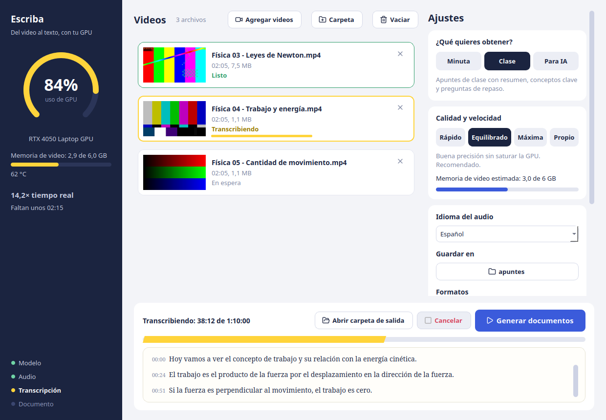
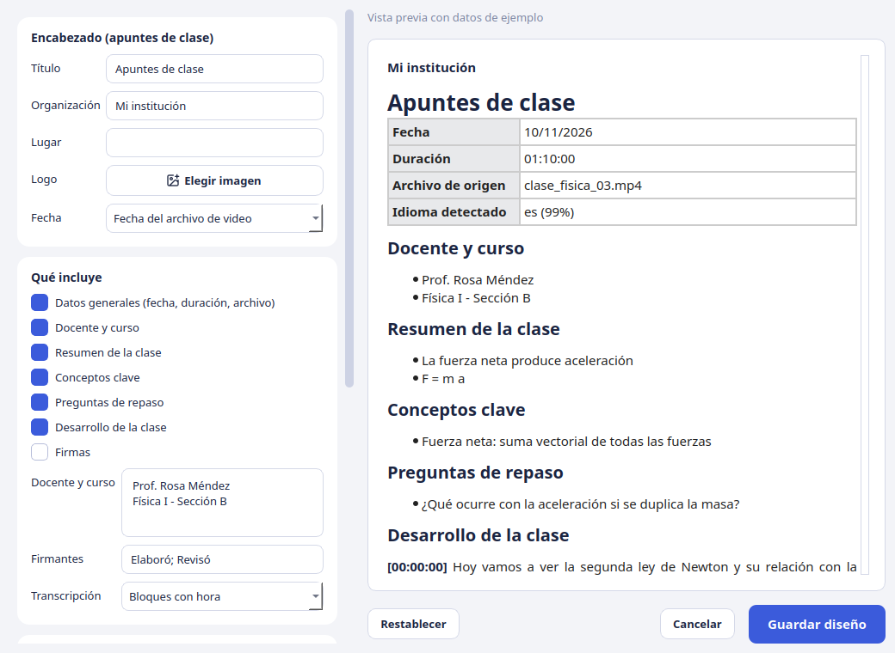

# Escriba

**Del video al texto, con tu GPU.**

Escriba convierte cualquier video en texto: **minutas de reunión**, **apuntes de clase** o **transcripciones en Markdown listas para dárselas a una IA** (ChatGPT, Claude, Gemini, NotebookLM…). La transcripción corre en los Tensor Cores de tu GPU NVIDIA RTX con [faster-whisper](https://github.com/SYSTRAN/faster-whisper), así que una hora de video se transcribe en pocos minutos y todo ocurre en tu equipo: el audio no sale de tu computadora.



## Para qué sirve

| Quieres… | Elige | Obtienes |
|---|---|---|
| Acta de una reunión | **Minuta** | Participantes, acuerdos, pendientes, firmas |
| Estudiar una clase grabada | **Clase** | Resumen, conceptos clave y preguntas de repaso |
| Pasarle un video a una IA | **Para IA** | Markdown limpio con cabecera de datos, opcionalmente partido en fragmentos |

- Acepta videos sueltos o carpetas completas (mp4, mkv, avi, mov, webm, flv…). Detecta los archivos por contenido, no por extensión.
- Salida en **Markdown, Word, texto plano, subtítulos (.srt) y JSON** con marcas de tiempo.
- Perfiles de un clic (Rápido, Equilibrado, Máxima calidad) o ajuste fino de modelo, precisión, lote y tope de uso de GPU.
- **Tú decides cómo se ve el documento**: título, organización, logo, secciones, formato de la transcripción, letra, papel, márgenes, color, numeración de páginas y firmas, con vista previa en vivo.
- Opcional: resumen estructurado (temas y acuerdos, o conceptos y preguntas de repaso) con la API de Claude. Requiere internet y una clave propia; sin ella todo funciona igual.



### Usarlo con una IA

1. Elige **Para IA** y marca Markdown.
2. En *Diseño del documento*, sección *Para usar con una IA*, activa la cabecera de datos y, si la IA tiene límite de contexto, parte el archivo en fragmentos de unas 8 000 palabras.
3. Sube el `.md` (o los fragmentos) a la IA y pídele el resumen, un examen, un plan de estudio, etc.

## Requisitos

- Linux con una GPU NVIDIA (RTX recomendada) y su controlador instalado.
- Python 3.10 o superior.
- `ffmpeg` (`sudo apt install ffmpeg`).

Con 6 GB de memoria de video funcionan todos los perfiles; `large-v3-turbo` en el perfil Equilibrado usa unos 3 GB.

## Instalación

```bash
git clone https://github.com/LightDemon12/escriba.git
cd escriba
./lanzar.sh                       # crea el entorno la primera vez y abre la aplicación
./packaging/instalar-lanzador.sh  # opcional: agrega «Escriba» al menú de aplicaciones
```

La primera vez que uses un modelo se descarga de Hugging Face (`large-v3-turbo` pesa unos 1,6 GB). Después funciona sin conexión.

Como paquete:

```bash
python3 -m venv .venv && . .venv/bin/activate
pip install -e .            # o pip install -e ".[resumen]" para el resumen con Claude
escriba                     # interfaz gráfica
escriba-cli clase.mp4 -t clase
```

## Línea de comandos

```bash
escriba-cli reunion.mkv                                  # minuta en .md y .docx
escriba-cli clases/ -t clase -o apuntes -l es            # una carpeta entera
escriba-cli video.mp4 -t transcripcion -f md --partir 8000   # para IA, en fragmentos
escriba-cli video.mp4 -f md,txt,srt,json                 # varios formatos
escriba-cli reunion.mp4 --diseno mi_diseno.json          # diseño propio
escriba-cli reunion.mp4 --resumen                        # requiere ANTHROPIC_API_KEY
```

`--diseno` recibe un JSON con los campos de `DocConfig` (ver `escriba/documento.py`); la interfaz guarda y usa el mismo formato.

## Perfiles

| Perfil | Modelo | Precisión | Lote | Para qué |
|---|---|---|---|---|
| Rápido | small | float16 | 16 | Borradores |
| Equilibrado | large-v3-turbo | float16 | 8 | Uso diario (recomendado) |
| Máxima calidad | large-v3 | int8_float16 | 4 | Audio difícil o con ruido |

## Uso responsable

Transcribir reuniones o clases puede requerir el consentimiento de quienes participan o aparecen en la grabación; consulta las normas de tu organización y las leyes de tu país. Whisper puede equivocarse (nombres propios, cifras, términos técnicos): revisa el resultado antes de usarlo como documento oficial.

## Desarrollo

```bash
pip install -e ".[dev]"
ruff check .
pytest
```

Consulta [CONTRIBUTING.md](CONTRIBUTING.md) para colaborar.

## Licencia

[MIT](LICENSE). Las dependencias, los modelos, los iconos (Lucide) y los programas externos tienen sus propias licencias; consulta [THIRD_PARTY_NOTICES.md](THIRD_PARTY_NOTICES.md). NVIDIA, CUDA, RTX, Whisper, Claude y Qt son marcas de sus respectivos dueños; este proyecto no está afiliado a ellos.
